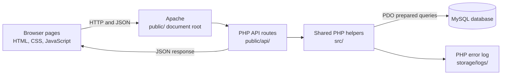

# Architecture

Yapp has three main parts: browser pages, a PHP JSON API, and a MySQL database. The browser uses JavaScript `fetch()` calls to ask the API for data. PHP checks the request, applies the rules, and reads or changes data in MySQL.

## Main parts

- `public/` contains pages, browser assets, and API routes. It is the web server's document root.
- `public/api/` contains small PHP files for each API action. Apache rewrite rules let many requests use clean URLs without the `.php` ending.
- `src/common.php` contains the database connection, JSON responses, session handling, and login and admin checks.
- `src/tweet_helpers.php` prepares shared post data for API responses.
- `database/` contains the schema, demo data, and upgrade script.
- `config/config.php` contains local database settings. It is outside the public folder.

The API uses PDO prepared statements to pass values into SQL. Most database access happens directly in the route file, with shared session and post helpers where needed. PHP exceptions are logged in `storage/logs/app.log`; API clients receive a general server error.
