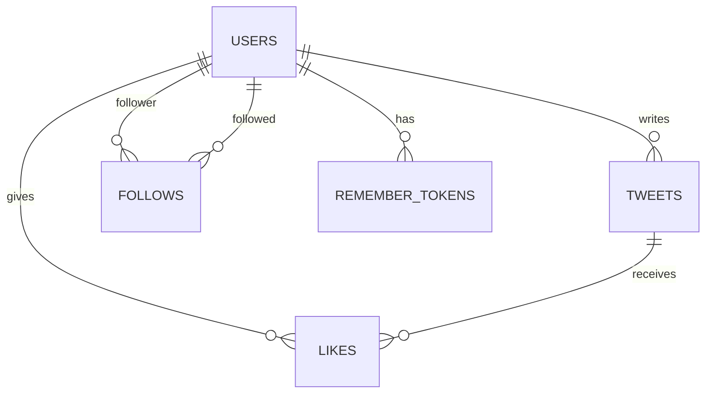

# Database

Yapp uses MySQL and InnoDB. The schema is in `database/schema.sql`; optional starter records are in `database/seed.sql`. All tables use `utf8mb4` text encoding.

## Tables

| Table | What it stores | Important rules |
|---|---|---|
| `users` | Accounts, profile text, password hash, and role | Unique username and email. Role is `user` or `admin`; new accounts default to `user`. |
| `tweets` | Short posts and their timestamps | Each post belongs to a user. Content is limited to 280 characters by the API. `deleted_at` marks a removed post. |
| `follows` | Which account follows which other account | Both IDs refer to users. A unique pair prevents duplicate follows. |
| `likes` | Which account likes which post | The user/post pair is the primary key, so one account can like a post once. |
| `remember_tokens` | Persistent login token records | Stores a selector and a hash of the validator, never the raw validator. Deleting an account removes its tokens. |

The `users` table has `id`, `username`, `email`, `password_hash`, `display_name`, `role`, `bio`, `created_at`, and `updated_at`. `tweets` has `id`, `user_id`, `content`, `created_at`, `edited_at`, and `deleted_at`. Relationship tables include creation times. Foreign keys remove dependent posts, follows, likes, or remember tokens when a user is deleted.

The database uses UTC for application timestamps. The API uses prepared statements for user-provided values.
