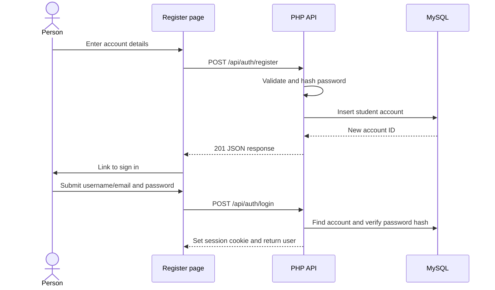

# Main flows

## Create an account and sign in

## Open a protected page

The page JavaScript calls `GET /api/auth/me`. If there is no valid session or remember token, the API returns `401` and the browser sends the person to the login page. Otherwise, it loads page data such as the feed, profile, or admin list.

## Publish, edit, or delete a post

The browser sends a JSON request to `/api/tweets`. PHP checks the session and validates that the post has 1 to 280 characters. Edit and delete also check that the signed-in account owns the post. Delete sets `deleted_at` instead of removing the row.

## Follow and like

The browser sends `POST` to add a follow or like and `DELETE` to remove it. PHP uses the signed-in account as the acting user, checks the target exists, and returns the new relationship state and count. A user cannot follow their own account.

## Search and profiles

Search asks for matching usernames or display names. A profile page loads public profile details and then loads that account's posts. The signed-in user can edit their own profile or follow another account. Follower and following pages load results in batches using a cursor.

## Admin page

The admin page loads `GET /api/admin/users`. PHP checks the current account's role before returning account details. A non-admin gets `403`; a signed-out visitor gets `401`.
